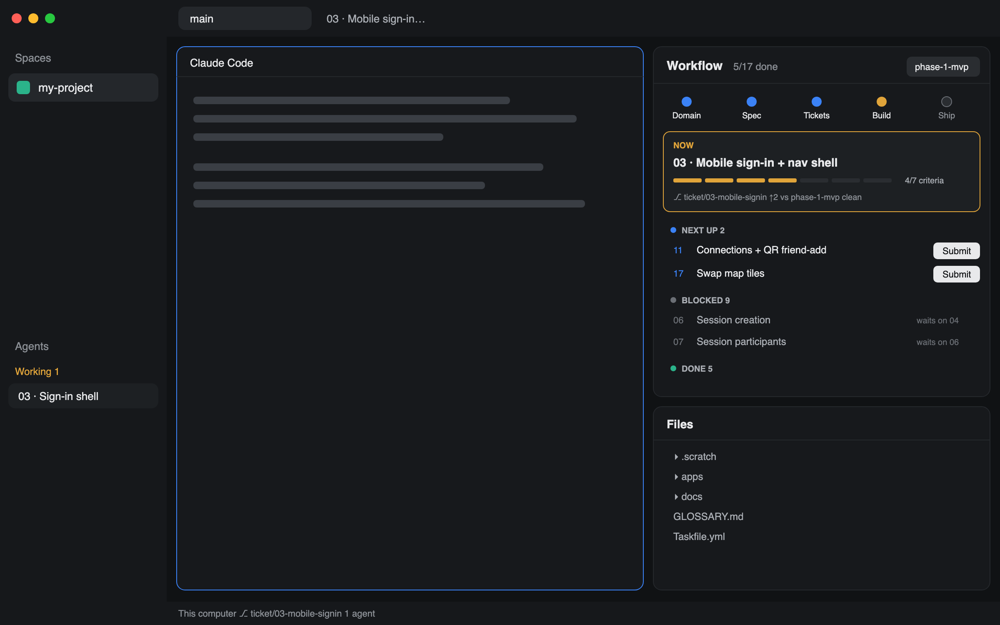

# Herdr layout for mattpocock-skills

A [Herdr](https://herdr.dev) layout for projects run with
[Matt Pocock's skills](https://github.com/mattpocock/skills) and their local-markdown issue
tracker. A **Workflow** panel next to your agents keeps the project's state in view: where the
spec stands, which ticket is being built right now, what's next, and what's blocked.



## What you get

Herdr's default layout (spaces and agents on the left, tabs, terminals) plus a right-hand column:

- **Workflow** (top)
  - **Pipeline:** Domain (glossary terms, ADRs) → Spec (user stories) → Tickets → Build (done of
    total) → Ship (merged to `main`). The stage you're on pulses.
  - **Now:** the ticket for your current `ticket/NN-…` branch, its acceptance criteria as a
    progress bar, the branch, commits ahead of the effort branch, and uncommitted changes.
  - **Lanes:** In progress, Needs you, Next up, Blocked (with what each waits on), Done and
    Won't fix. A Done ticket whose comments list follow-ups gets a `follow-ups` chip.
  - **Ticket view:** click any ticket to read it. Its `- [ ]` acceptance criteria are real
    checkboxes; ticking one saves the ticket file.
  - **Submit:** on Next-up tickets. Opens a new tab in the repo root, named `NN · Title`, running
    `claude --model opus "/mattpocock-skills:implement N"`.
  - **Last session note:** the newest entry in `.remember/now.md`, if you use the Remember plugin.
- **Files / Changes** (bottom): Herdr's own panels, switched from the tab bar.

## Install

Requires Herdr (macOS or Linux).

```sh
git clone https://github.com/jnopnop/herdr-layout-matt-pocock-skills.git
cd herdr-layout-matt-pocock-skills
./install.sh
```

The installer copies `layouts/mattpocock-skills.*` and `mods/mattpocock-workflow/` into
`~/.config/herdr-app/` (or `$HERDR_APP_HOME`), checks the mod loads, and switches Herdr to the
layout. It never overwrites files it didn't install. `ctrl-shift-l` cycles back to your other
layouts at any time.

- **Update:** `git pull && ./install.sh`
- **Uninstall:** `./install.sh --uninstall`

Or ask your agent to add `herdr.dev/layouts/jnopnop/herdr-layout-matt-pocock-skills`. `RECIPE.md`
lets it build the layout from scratch.

## What it expects from your repo

| Needs | Used for |
|---|---|
| `.scratch/<feature>/spec.md` and `.scratch/<feature>/issues/NN-<slug>.md`, the local-markdown tracker the skills' setup writes | everything. Without `.scratch/` the panel says so and shows nothing else |
| `Status:` and `Blocked by:` lines near the top of each ticket (`**Status:**` works too) | lanes and blockers |
| Ticket branches named `ticket/NN-…` | marking a ticket in progress before its status says so |
| `GLOSSARY.md`, `docs/adr/*.md` | the Domain stage |
| `claude` on your PATH with the mattpocock-skills plugin | the Submit button |

Several features under `.scratch/` get a picker in the panel's header.

The panel runs `git` and `sh` in the open repo, reads its files, and writes a ticket file only
when you tick a checkbox. Nothing leaves your machine.

## Develop

```sh
./dev.sh start    # macOS: background sync from this checkout into Herdr, survives logins
./dev.sh stop
./dev.sh run      # foreground sync (Linux, or to watch it)
./dev.sh status
```

Edit `layouts/` or `mods/` here and Herdr hot-reloads within a second. The sync copies files
instead of symlinking because Herdr doesn't follow links out of its own folder. Run
`herdr-app check ~/.config/herdr-app/mods/mattpocock-workflow` after changing the mod;
`herdr-app status` lists load errors.

## License

[MIT](LICENSE)
