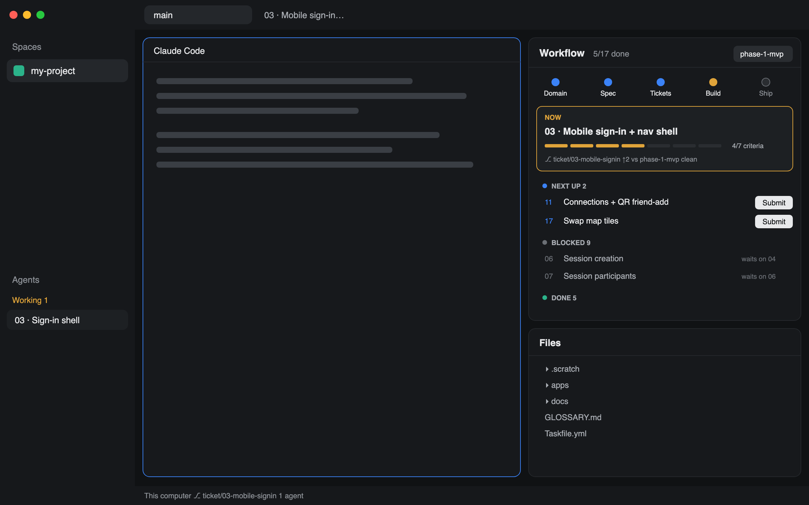

# mattpocock-skills

Herdr's default window with a project-state panel on the right for repos that use Matt Pocock's
skills and their local-markdown tracker. At a glance you see which stage the work is in, the
ticket being built now and how far along it is, what's next, what's blocked, and what needs a
human. Next-up tickets start an Opus implementation run in a new tab with one click.

## What you see

Left to right, top to bottom, as Herdr's `main` layout (`cloned_from` main 0.1.13):

- **Sidebar, 268px, `chrome`:** `workspace-chrome` brand bar (46px), `spaces` and `agents` lists
  (equal weights, min 90px each), `workspace-chrome` footer (69px).
- **Work column:** `tabs` bar (42px); a row with padding 8 and gap 8 holding the active tab's
  panes (cards, radius 10, `pane` header 30px) and the right column; `workspace-status` bar
  (28px).
- **Right column, 420px (min 280, max 900), shown, gap 8:**
  - **Workflow** (weight 3, min 200): a card (radius 10, `background`, 1px `border`), 13px text.
    - Header (42px): "Workflow", `done/total done` in `dim`, and one pill per feature folder in
      `.scratch/` (the selected one `selected`).
    - Pipeline: five stages in a row, each a 10px dot, a 10px semibold label and a 9px subline:
      Domain (`<terms>T · <n> ADR`), Spec (`<n> stories`), Tickets (`<n>`), Build
      (`done/total`), Ship (`in main` / `not merged`). Done stages are `done`; the first
      unfinished one is `working` and pulses opacity 0.45→1 over 1.4s; later ones are hollow.
    - Now card (`surface`, radius 8, 1px `working` border when a ticket is active): "NOW",
      the ticket's status chip, `NN · Title` in 14px semibold, one 5px segment per acceptance
      criterion (`working` when ticked, `raised` when not) with `x/y criteria`, and a git line:
      `⎇ branch`, `↑N vs <base>`, `clean` or `N uncommitted` (in `blocked`). With nothing in
      progress it says "Nothing in progress. Next up: NN Title".
    - Last session note (`surface` card): "LAST SESSION NOTE · <heading>" and up to 320
      characters of the newest `## ` entry in `.remember/now.md`. Hidden when there's none.
    - Lanes, in order: In progress (`working`), Needs you (`blocked`), Next up (`accent`),
      Blocked (`dim`), Done (`done`), Won't fix (`dim`). Each lane header is a chevron, a 7px
      dot, the uppercase name and a count; empty lanes are left out. Rows are 30px: number in
      the lane color, title (muted for Done and Blocked), then a hint (`waits on 04, 06` for
      Blocked, the status for Needs you, the branch for In progress), a `follow-ups` chip,
      `x/y` criteria, and for Next up a **Submit** button (`solid` / `solid_foreground`;
      `raised` / `muted` "Started" once clicked).
  - **Files / Changes** (weight 2, min 140): a stack of Herdr's shipped `files` and `changes`
    mods, chosen from the tab bar's buttons.

## How it behaves

- Follows the focused pane: its folder's git top level is the project. No `.scratch/` there:
  "No .scratch/ tracker in this repo."
- Lane of each ticket in `.scratch/<feature>/issues/NN-*.md`, from its `Status:` line
  (`**Status:**` too; default `needs-triage`):
  done/resolved/closed/complete(d) → Done; `wontfix` → Won't fix; in-progress/claimed/wip/
  doing/in-review/review, or a `ticket/NN-…` (or `issue/NN`) branch that's checked out or not
  yet merged into the feature branch → In progress; needs-triage/needs-info/ready-for-human →
  Needs you; anything else → Next up when every ticket number in `Blocked by:` is Done, else
  Blocked. Numbers in `Blocked by:` that aren't tickets ("Expo SDK 58") are ignored.
- The Now ticket is the one for the checked-out branch, else the first In progress.
- Feature picked: the remembered one (`localStorage`), else one whose name matches the
  current or a local branch, else the first. Clicking a header pill switches.
- Click a lane header: fold or unfold it (Done and Won't fix start folded).
- Click a row or the Now card: the ticket view. The header becomes `← NN · Title`; below it the
  lane chip, the criteria segments and the file name, then the ticket as markdown with every
  `- [ ]` / `- [x]` line (outside code fences) drawn as a 15px checkbox (`done` fill and ✓ when
  ticked) with its text as markdown. Clicking one re-reads the file, checks that line is
  unchanged, flips `[ ]`↔`[x]`, and writes the file only if it's still what was read
  (`writeTextFile` with the expected text). A changed line or a remote machine shows a warning
  toast instead. ← goes back.
- **Submit** (Next-up rows, and the ticket view of a Next-up ticket): `tab.new` in the active
  space with `name: "NN · Title"`, `folder: <repo root>`, `argv: ["claude", "--model", "opus",
  "/mattpocock-skills:implement N"]` (N without leading zeros). The button then reads "Started"
  until the panel reloads.
- Refreshes when anything under `.scratch/` changes (`watchFolder`, this machine only) and
  every 15s for git state and the session note.
- Agent statuses (working, blocked, done, idle) show in Herdr's own sidebar and tabs; this
  layout doesn't change them.

## Built from

- `layouts/mattpocock-skills.json`: Herdr's `main` tree with the `panel` column shown, sized
  420px, its children replaced by a `workflow` block (`mattpocock-workflow`) over the
  `panel-body` stack (`files`, `changes`). Root `preview: layouts/mattpocock-skills.svg`.
- `mods/mattpocock-workflow/` (`place: none`), its chevron SVGs drawn with `svg()`.
  - From `herdr`: `spaces`, `panes`, `focused`, `exec`, `readTextFile`, `writeTextFile`,
    `watchFolder`, `theme`, `notify`, `run("tab.new")`.
  - From `gpui-base`: `v_flex`, `h_flex`, `TextView.markdown`.
  - Programs: `git` (`rev-parse --show-toplevel`, `branch --show-current`, `for-each-ref`,
    `branch --merged`, `rev-list --count`, `status --porcelain`, `merge-base --is-ancestor`,
    read-only flags `--no-optional-locks -c core.fsmonitor=false`) and `sh` to list
    `.scratch/*/`, `.scratch/*/issues/*.md` and `docs/adr/*.md`.
- Shipped mods used as-is: `workspace-chrome`, `spaces`, `agents`, `tabs`, `pane`, `files`,
  `changes`, `workspace-status`.

## Watch out

- Herdr doesn't follow symlinks out of its own folder: a linked layout or mod never reloads.
  Develop by copying (this repo's `dev.sh`).
- A checkbox's click handler sits on its whole row (box and text), so the text is clickable too.
- The Submit button stops the press (`on_mouse_down` + `cx.stop_propagation()`) or the row
  behind it opens the ticket too.
- Ticket numbers are compared as two-digit strings (`04`); branch numbers are padded to match.
- `Blocked by:` is parsed for two-digit numbers, so only numbers that are real tickets count.
- Checkbox edits need the repo on this machine (`writeTextFile` is local only).
- Assumes the `claude` CLI and the mattpocock-skills plugin for Submit; the run commits to
  whatever branch the repo root has checked out.

## Done when

- In a repo with `.scratch/<feature>/issues/`, every ticket appears in exactly one lane, and
  Blocked rows name only unfinished tickets.
- On a `ticket/NN-…` branch, ticket NN is the Now card and sits in In progress.
- Ticking a checkbox in the ticket view changes that line in the file on disk and the
  `x/y` counts at once; editing the file elsewhere then ticking shows a warning and reloads.
- Submit on a Next-up row opens a tab named `NN · Title` in the repo root running
  `claude --model opus "/mattpocock-skills:implement N"`, and doesn't open the ticket view.
- In a repo without `.scratch/`, the panel shows only its empty message.
- `herdr-app check mods/mattpocock-workflow` passes and `herdr-app status` shows no errors.
